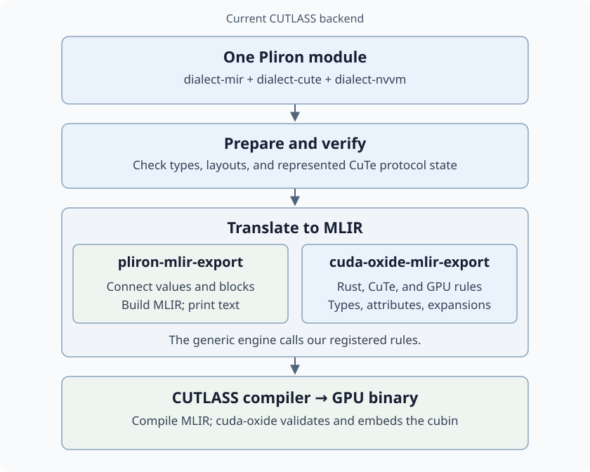

# How our Pliron operations become MLIR

For the CUTLASS backend, cuda-oxide translates a Pliron program into MLIR text,
then asks the pinned CUTLASS compiler to build the GPU binary.

`dialect-mir`, `dialect-cute`, and `dialect-nvvm` can all appear in the same
module. They describe different parts of the program; they are not three
successive compilation stages.

## What gets mapped?

| Pliron input | MLIR output |
| --- | --- |
| MIR arithmetic, functions, branches, and memory | `arith`, `func`, `cf`, and `llvm` operations |
| CuTe tensors, copies, and matrix multiplication | CUTLASS `cute` / `cute_nvgpu` operations and supporting instructions |
| NVVM thread-index reads and supported GPU instructions | MLIR `nvvm` operations or instruction sequences |

For example, an integer `mir.add` becomes `arith.addi`. A thread-index read
becomes `nvvm.read.ptx.sreg.tid.x`.

Mapping includes types and attributes, not just operation names. A single
source operation can expand into several target operations. Compile-time
CuTe state can disappear after its checks have succeeded.

## Which crate does what?

- **`cuda-oxide-mlir-export` supplies the rules:** how Rust values, CuTe
  operations, and GPU instructions map to the selected CUTLASS version.
- **`pliron-mlir-export` supplies the machinery:** look up each rule, keep
  values and blocks connected, build a typed MLIR syntax tree, and print it.
  An unregistered operation, type, or attribute is an error.
- **CUTLASS compiles the text:** cuda-oxide extracts and validates the resulting
  cubin, then embeds it for the normal CUDA launch path.

The two export crates work together: the generic engine calls our registered
rules during translation.

Shared preparation and CuTe verification happen before export. Checks cover
the represented layouts and protocol state; dynamic thread participation,
phases, and pointer lifetimes still have caller obligations.

The native backend takes a separate route through LLVM. This diagram describes
`CUDA_OXIDE_DEVICE_BACKEND=cutlass-mlir`.

## Where upstream interop fits

[`pliron-mlir-interop`](https://github.com/pliron-org/pliron-mlir-interop)
serves the same broad purpose as our generic exporter. It uses
`ToMlirOp`, `ToMlirType`, and `ToMlirAttr` implementations to print MLIR;
our current exporter uses a mapping registry and an intermediate syntax tree.

Upstream already supports user-defined translations. Our CUDA/CuTe rules,
Rust layout handling, safety checks, and CUTLASS version policy remain ours.
Adopting its interfaces requires adapting those rules; changing the dependency
alone would not replace the current exporter.

See the [interop assessment](reference/pliron-mlir-interop.md) for what works
with existing extension points and which generic improvements may be useful.

## Read or run it

- [Build with the CUTLASS backend](translation.md).
- [Our mapping rules](../../crates/cuda-oxide-mlir-export/README.md).
- [The generic exporter](../../crates/pliron-mlir-export/README.md).
